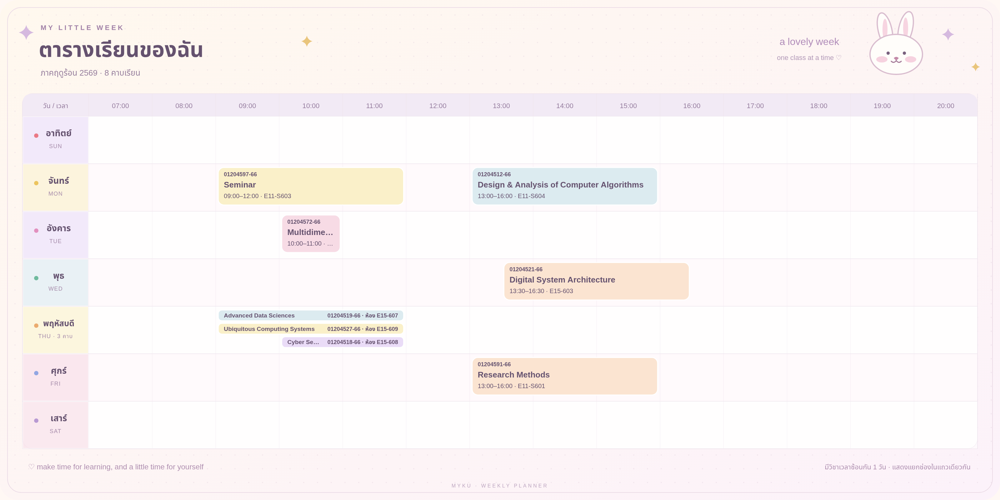

# MyKU Timetable 1.2.1 — ตารางพาสเทล 16:8 และดาวน์โหลด PNG

ส่วนขยาย Chrome Manifest V3 สำหรับ https://my.ku.th/myku/student/std/classroom

เก็บแท็บตารางเรียน MyKU เดิมเป็นค่าเริ่มต้น และเพิ่มแท็บ **ตารางรายสัปดาห์** ธีมครีม–ชมพู–ม่วงพาสเทล พร้อมกระต่ายและดาวที่วาดด้วย SVG แถววันทั้ง 7 สูงเท่ากัน ภาพตารางเป็นสัดส่วน **16:8** ทั้งบนหน้าเว็บและเมื่อดาวน์โหลด

[หน้าติดตั้งและตัวอย่าง](https://PuemMTH.github.io/myku-timetable-extension/) · [ดาวน์โหลด ZIP ล่าสุด](https://github.com/PuemMTH/myku-timetable-extension/releases/latest/download/myku-timetable-extension.zip) · [Releases](https://github.com/PuemMTH/myku-timetable-extension/releases)



## ติดตั้งและอัปเดต

1. [ดาวน์โหลด `myku-timetable-extension.zip`](https://github.com/PuemMTH/myku-timetable-extension/releases/latest/download/myku-timetable-extension.zip) แล้วแตกไฟล์ไว้ในโฟลเดอร์ถาวร
2. เปิด `chrome://extensions` ใน Chrome แล้วเปิด **Developer mode**
3. กด **Load unpacked** และเลือกโฟลเดอร์ `myku-timetable-extension` ที่มี `manifest.json`
4. รีเฟรชหน้า MyKU ล็อกอินตามปกติ แล้วเปิด **ตารางเรียน/ตารางสอบ**

ถ้าใช้รุ่นก่อนหน้าอยู่ ให้แทนไฟล์ในโฟลเดอร์เดิมด้วยรุ่น 1.2.1 กด **Reload** ของส่วนขยาย แล้วรีเฟรช MyKU ไม่ต้อง build หรือติดตั้ง Node.js เพื่อใช้งาน อย่าลบหรือย้ายโฟลเดอร์ที่โหลดไว้

อ้างอิงการติดตั้ง: https://developer.chrome.com/docs/extensions/get-started/tutorial/hello-world#load-unpacked

### สคริปต์ออนไลน์สำหรับ Linux และ macOS

ต้องมี `curl`, `python3` และ Bash:

```bash
curl -fsSL https://PuemMTH.github.io/myku-timetable-extension/install.sh | bash
```

[อ่านสคริปต์ก่อนเรียกใช้](install.sh) สคริปต์ดาวน์โหลด ZIP และ `SHA256SUMS` จาก GitHub Release ล่าสุด ตรวจ SHA-256 และโครงสร้างแพ็กเกจก่อนเขียนไฟล์ ไม่แก้ Chrome profile, enterprise policy หรือการตั้งค่าความปลอดภัยของเบราว์เซอร์

โฟลเดอร์ที่ติดตั้ง:

- Linux: `${XDG_DATA_HOME:-$HOME/.local/share}/myku-timetable-extension`
- macOS: `~/Library/Application Support/MyKU Timetable`

เมื่อติดตั้งครั้งแรกต้องเปิด `chrome://extensions` แล้วกด **Load unpacked** เลือกโฟลเดอร์นี้หนึ่งครั้ง เมื่ออัปเดตให้กด **Reload** ของส่วนขยายและรีเฟรช MyKU ไฟล์อื่นที่อยู่ในโฟลเดอร์เดียวกันจะถูกเก็บไว้ Windows ใช้วิธี ZIP ด้านบนได้

ส่วนขยายนี้ยังไม่ได้เผยแพร่ใน Chrome Web Store หน้าเว็บและสคริปต์จึงไม่สามารถติดตั้งเข้า Chrome ให้เสร็จโดยข้ามขั้นตอนของเบราว์เซอร์ได้ ดู [วิธีเผยแพร่ที่ Chrome รองรับ](https://developer.chrome.com/docs/extensions/how-to/distribute)

## ใช้งานและดาวน์โหลดภาพ

- แท็บ **ตารางเรียน** เปิดรายการ MyKU เดิมตามปกติ รวมถึงการกดอ่านประกาศ
- เลือก **ตารางรายสัปดาห์** เพื่อดูธีมพาสเทล แล้วกด **↓ ดาวน์โหลด PNG**
- ได้ไฟล์ PNG **3200 × 1600 พิกเซล** หรือสัดส่วน **16:8** ชื่อไฟล์มีภาคเรียนและปี ขนาดภาพคงเดิมแม้ดาวน์โหลดจากหน้าจอแคบ
- ไฟล์ภาพมีเฉพาะตารางและลวดลาย ไม่ติดปุ่มดาวน์โหลด แถบเมนู หรือข้อมูลบัญชีจากหัวเว็บ
- ภาพตัวอย่างและ PNG ใช้ SVG ต้นฉบับเดียวกัน สีและตำแหน่งข้อมูลจึงตรงกัน ไม่มีภาพตกแต่งจากเว็บภายนอก
- คลิกการ์ด หรือใช้ Tab แล้ว Enter/Space เพื่อดูชื่อไทย/อังกฤษ เวลา หมู่ ห้อง และผู้สอนเต็ม กด Escape เพื่อปิด
- คลิกชื่อวันเพื่อเปิดรายการทุกคาบของวันนั้น แล้วเลือกวิชาที่ต้องการ วิธีนี้ช่วยอ่านวันที่มีคาบซ้อนกันหลายวิชา
- แถวทั้ง 7 มีความสูงเท่ากัน 76 หน่วยใน SVG และย่อ/ขยายพร้อมภาพ ความสูงจริงบนจอขึ้นอยู่กับความกว้างภาพ
- วิชาที่เวลาซ้อนกันแบ่งช่องย่อยภายในแถวเดียวกันทั้งหมด จำนวนคาบมากขึ้นจะย่อการ์ดลง โดยยังเปิดอ่านข้อมูลเต็มได้
- คาบที่ซ้อนกันแสดง **รหัสวิชาและห้องเรียนบนการ์ด** ทั้งในเว็บและ PNG เมื่อซ้อนตั้งแต่ 3 คาบจะสงวนพื้นที่ด้านขวาสำหรับข้อมูลนี้ และย่อชื่อวิชาด้านซ้ายตามพื้นที่ที่เหลือ
- หน้าจอแคบเลื่อนภาพแนวนอนได้ ภาพทั้งแผ่นมีสัดส่วนเดิม
- รายการที่อ่านวันหรือเวลาไม่ได้ยังแสดงในรายการ MyKU ด้านล่าง และมีข้อความระบุจำนวนในภาพด้วย ไม่ได้ใส่คาบที่ไม่ทราบเวลาในช่องเวลาโดยเดา
- ช่วงเวลาปกติ 07:00–21:00 น. ขยายให้เองหากมีคาบก่อนหรือหลังช่วงนี้
- แท็บสอบกลางภาคและปลายภาคใช้หน้าของ MyKU ตามเดิม

เปิด `demo.html` เพื่อดูตัวอย่างโดยไม่ต้องล็อกอิน ข้อมูลใน demo และภาพที่ส่งมอบเป็นข้อมูลสมมติ

## โค้ดและข้อมูล

- `manifest.json`: ขอบเขตเว็บและลำดับ content scripts
- `schedule.js`: อ่านเวลา จัดช่องคาบซ้อนกัน เลือกสี และย่อข้อความโดยไม่ตัดเครื่องหมายภาษาไทย
- `artwork.js`: สร้าง SVG 1600 × 800 และส่งออก PNG 3200 × 1600 ด้วย Canvas
- `content.js`: อ่านการ์ด MyKU จัดแท็บ เปิดรายละเอียด และปุ่มดาวน์โหลด
- `content.css`: แถบควบคุม dialog และการแสดงภาพในหน้าเว็บ
- `tests/schedule.test.cjs`: unit tests ไม่ใช้ dependency
- `tests/artwork-check.html`: เปิดใน Chrome เพื่อตรวจว่าคาบซ้อนกัน 2/3/4 คาบแสดงรหัสและห้องครบ ข้อความไม่ล้นหรือทับชื่อวิชา และส่งออก PNG ได้
- `install.sh`: ดาวน์โหลดและเตรียมส่วนขยายจาก Release ล่าสุด
- `scripts/package.py`: สร้าง ZIP สำหรับติดตั้งพร้อม SHA-256 โดยรวมเฉพาะ runtime และ README
- `index.html`, `install-page.css`, `install-page.js`: หน้าติดตั้งที่เผยแพร่ผ่าน GitHub Pages

อ่านเฉพาะ DOM ไม่อ่าน cookies, tokens หรือรหัสผ่าน ไม่เรียก API ไม่แก้การลงทะเบียน และไม่ส่งข้อมูลออกนอกเครื่อง การส่งออกทำในเบราว์เซอร์ด้วย SVG/Canvas ไม่เพิ่มสิทธิ์ downloads, background service หรือ dependency ภายนอก

ทำงานบน `https://my.ku.th/myku/student/*` เพื่อรองรับการเปลี่ยนหน้าผ่านเมนูแบบ SPA และเพิ่ม UI เฉพาะเส้นทางตารางเรียน ปิดส่วนขยายแล้วรีเฟรชเพื่อคืนหน้าปกติ

อ้างอิงวิธีส่งออก: [Canvas toBlob](https://developer.mozilla.org/en-US/docs/Web/API/HTMLCanvasElement/toBlob), [XMLSerializer](https://developer.mozilla.org/en-US/docs/Web/API/XMLSerializer)

## ตรวจสอบเมื่อ 19 พฤศจิกายน 2569

รัน unit tests ด้วย `pnpm test` หรือ `node --test tests/*.test.cjs`

รันทดสอบ installer ด้วย `pnpm test:installer` หรือ `python3 -m unittest discover -s tests -p 'test_*.py'` ทดสอบการติดตั้ง/อัปเดต การเก็บไฟล์เดิม checksum ผิด แพ็กเกจไม่ปลอดภัย เครือข่ายล้มเหลว และโฟลเดอร์แบบ symlink โดยไม่แตะ Chrome profile จริง CI รันทดสอบทั้งสองชุดบน Linux

- unit tests 5 ชุดผ่าน: เวลาไม่ถูกต้อง/24:00, คาบต่อกัน/ชนกัน, ช่วงเวลาเช้า–ค่ำ, 1–8 คาบในแถวคงที่ และการย่อข้อความภาษาไทย
- MyKU ที่ล็อกอินจริง: อ่านครบ 6 วิชา ยืนยันแถวทั้ง 7 เท่ากันและ viewBox 1600 × 800 สร้าง PNG จากตารางจริงในหน่วยความจำได้ 3200 × 1600 โดยไม่มีการส่งข้อมูลออกจากเครื่อง
- Chrome 157 โปรไฟล์ทดสอบแยก: ติดตั้ง extension จริงด้วย Manifest V3 และโหลด fixture ที่ origin MyKU ผ่านการจำลองเครือข่าย
- คลิกปุ่มดาวน์โหลดจริงแล้วตรวจไฟล์ที่เบราว์เซอร์บันทึก: ลายเซ็น PNG ถูกต้อง ขนาด 3200 × 1600 ชื่อภาคเรียน/ปีถูกต้อง ไฟล์นี้เป็น `sample-timetable.png`
- ตรวจภาพ PNG ที่ดาวน์โหลดและภาพหน้าเว็บด้วยสายตาแล้ว
- ทดสอบบังคับให้ขั้นตอนสร้างภาพล้มเหลว: แสดงข้อความให้ลองใหม่และเปิดใช้ปุ่มดาวน์โหลดอีกครั้งได้
- สลับแท็บเดิม/ใหม่, keyboard activation, รายการรายวัน, dialog/Escape, การแทน DOM ด้วยข้อมูลเดิม และแท็บสอบจำลองผ่าน
- ตรวจคาบซ้อนกัน 3–4 วิชาไม่ทับกันและอยู่ภายในแถว, DOM updates, คาบเช้า, ข้อความที่มีอักขระ HTML และ fallback เมื่อเวลาเป็น TBA ผ่าน
- ตรวจรหัสวิชาและห้องเรียนเป็นข้อความที่มองเห็นจริงบนการ์ดซ้อนกันทั้ง 2/3/4 คาบ ครบโดยไม่ตัดท้าย ตรวจกรอบข้อความไม่ล้นการ์ดและไม่ทับชื่อวิชา ผ่าน รวมถึงดาวน์โหลด PNG รุ่น 1.2.1 ใหม่แล้ว
- ทดสอบ SPA ออก/กลับเข้าหน้าเดิม และจอ 390px ผ่าน ไม่มี JavaScript page error ใน fixture

ข้อจำกัด: การ์ดที่แคบหรือมีคาบซ้อนกันมากจะแสดงชื่อย่อ ให้คลิกอ่านเต็มในเว็บ ภาพ PNG เป็นภาพนิ่งจึงคลิกอ่านรายละเอียดไม่ได้ ยังไม่ได้ทดสอบข้อมูลสอบจริงเพราะแท็บสอบในบัญชีปัจจุบันปิดใช้งาน หาก MyKU เปลี่ยนโครงสร้างการ์ดอาจต้องปรับ `readCard()`

## ไฟล์ส่งมอบ

- ZIP บน Releases: ไฟล์ runtime และ README พร้อมติดตั้ง โดยไม่รวมไฟล์พัฒนา
- repository นี้: source, demo, tests, สคริปต์ติดตั้ง และหน้าติดตั้ง
- `sample-timetable.png`: ไฟล์จากปุ่มดาวน์โหลดจริง ใช้ข้อมูลสมมติ สัดส่วน 16:8
- `preview.png`: ภาพหน้า demo พร้อมแท็บและปุ่มดาวน์โหลด
- `preview-original.png`: ภาพแท็บเดิมใน demo

ไม่มีข้อมูลบัญชีจริง รหัสผ่าน หรือ session ของ MyKU ในไฟล์ส่งมอบ

## สร้างแพ็กเกจและออกรุ่นใหม่

```bash
pnpm test
pnpm test:installer
pnpm package
```

ได้ `dist/myku-timetable-extension.zip` และ `dist/SHA256SUMS` ZIP ใช้ชื่อไฟล์และเวลาคงที่เพื่อให้ build ซ้ำจากไฟล์ชุดเดิมได้ checksum เดิม อัปเดตเลขรุ่นใน `manifest.json` และ `package.json` ก่อนสร้าง Release รุ่นต่อไป แล้วอัปโหลดสองไฟล์นี้เป็น assets ของรุ่นนั้น สคริปต์ออนไลน์จะเลือก Release ล่าสุด

ตรวจ checksum หลังดาวน์โหลดได้ด้วย `sha256sum -c SHA256SUMS` บน Linux หรือ `shasum -a 256 -c SHA256SUMS` บน macOS

GitHub Pages เผยแพร่จาก root ของ branch `main` โดยใช้ `.nojekyll` หน้าเว็บเป็นไฟล์ static ไม่ต้อง build และไม่ใช้ analytics โปรเจกต์นี้เป็นเครื่องมืออิสระ ไม่ใช่ระบบทางการของมหาวิทยาลัยเกษตรศาสตร์
